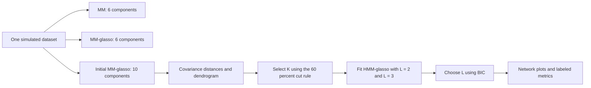
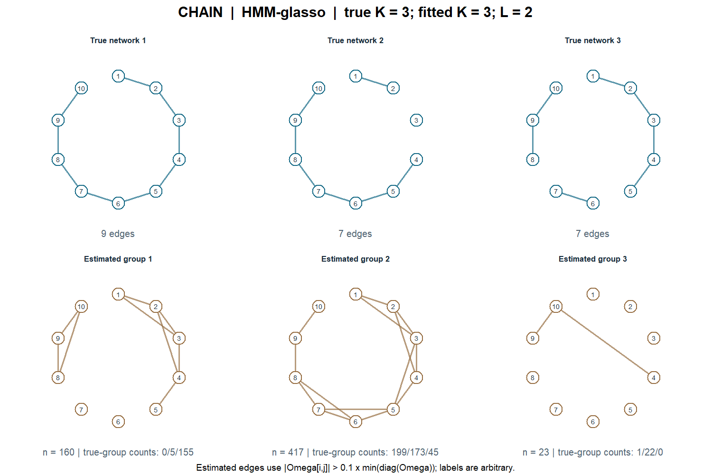
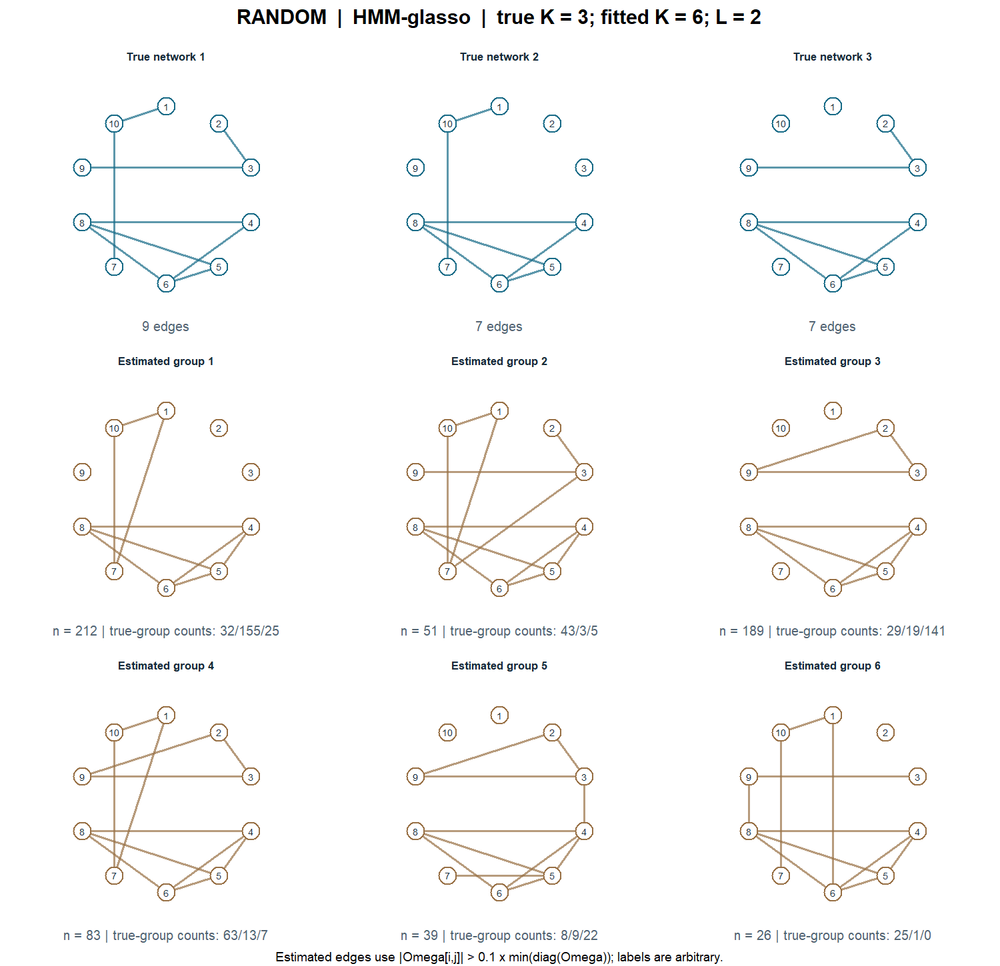

# HMM-glasso

**Hierarchical network clustering with graphical lasso.** An R implementation and a small, reproducible demonstration of the chain and random graph settings in *Hierarchical network clustering with glasso* by Xichen Mou, Hongmei Zhang, Yu Jiang, and Syed Hasan Arshad.

HMM-glasso models observations using several network groups. Within each group, Gaussian subclusters have different means but share a sparse precision matrix. Here **HMM means hierarchical mixture model**.

$$
f(x)=\sum_{k=1}^{K}\pi_k\sum_{\ell=1}^{L_k}\eta_{k\ell}
\phi_p(x;\mu_{k\ell},\Omega_k^{-1}).
$$

The implementation estimates group memberships, subcluster means, and precision matrices using EM-style responsibility updates and graphical lasso. A zero off-diagonal precision entry represents conditional independence **within the corresponding Gaussian subcomponent**. A mixture over different means need not retain that conditional independence after marginalizing the subcomponent.

## Run the showcase

Install [R](https://www.r-project.org/), download this repository, and run these commands from its root directory:

```sh
Rscript scripts/install_dependencies.R
Rscript demo.R
```

The demo generates **one dataset for the chain graph and one for the random graph**. There is no 200-replicate loop, no parameter grid, and no averaging across simulation runs. It uses `glasso`, `mvtnorm`, and `glmnet`; the installer keeps dependencies in a local `.Rlib/` folder. The demo was tested with R 4.5.2 on Windows.

Defaults: **600 observations, 10 variables, 3 true network groups, 2 mean subclusters per group**, mean shift 1, graph seed 123, and simulation seed 2026 (2126 for the random graph).

```sh
# Run just one graph type
Rscript demo.R --graph=chain
Rscript demo.R --graph=random

# Showcase fitting with the known top-level group count
Rscript demo.R --K=3

# Choose another paper setting, still only one dataset per graph
Rscript demo.R --p=20 --n=1200 --mean-shift=0.1

# Supply a penalty instead of running the original CV heuristic
Rscript demo.R --rho=0.1

# Include mixing-weight parameters in the BIC comparison
Rscript demo.R --bic=full

Rscript demo.R --help
```

In RStudio, open the repository as the working directory, run `source("scripts/install_dependencies.R")`, then `source("demo.R")`.

## What the demo does



**K selection:** by default, fit a 10-component MM-glasso, compute pairwise covariance Frobenius distances, use `hclust(method="ward.D")`, and cut at **0.6 times the maximum pairwise distance**. The resulting count determines K. This is not 60% of the maximum dendrogram height. The fitted HMM uses a fresh random initialization; dendrogram membership labels are not carried into that initialization. `--K=3` skips this preliminary fit and fixes K.

**L selection:** at that one K, fit common L = 2 and L = 3 and choose the lower BIC. BIC does not search over K. The default `--bic=legacy` preserves the parameter count in the original simulation script. Both legacy and full dense-parameter BIC values are saved; see [implementation notes](docs/implementation.md).

**Penalty selection:** the default preserves the original nodewise CV heuristic, including its additional last-variable CV standard-deviation term. This is not a conventional one-standard-error rule. Use `--rho=...` to supply an explicit value.

## Example output

These are the actual results of the included default showcase, with a single initialization for each candidate fit. Group labels are arbitrary; panels are not matched one-to-one.

| Graph | True K | Selected K | Selected L | HMM network ARI | HMM network purity |
|---|---:|---:|---:|---:|---:|
| Chain | 3 | 3 | 2 | 0.314 | 0.627 |
| Random | 3 | 6 | 2 | 0.306 | 0.748 |

### Chain graph



### Random graph



The random example illustrates that the dendrogram heuristic can overestimate K. These single-run outputs demonstrate the workflow; they do not establish comparative superiority or reproduce the manuscript's 200-replicate tables. Package versions and initializations can change numerical results.

See the [complete single-run metrics](examples/metrics.csv), [chain dendrogram](examples/chain-diagnostics.png), and [random dendrogram](examples/random-diagnostics.png).

## Reading the metrics

| Output | Target / interpretation |
|---|---|
| `network_ARI` | Adjusted Rand index against the **3 true network groups**, for every method. Penalizes splitting and merging. |
| `network_purity` | Many-to-one majority matching against the same 3 groups. Can increase when a partition is split; not one-to-one assignment accuracy. |
| `subcluster_ARI`, `subcluster_purity` | Separate evaluation against the **6 true mean subclusters**, for every method. |
| `assigned_edge_sensitivity`, `assigned_edge_specificity` | Each observation receives the precision matrix of its assigned fitted group; pool upper-triangle observation/edge pairs against its true network. These combine clustering and edge-estimation error. |
| `converged`, `iterations` | Whether the likelihood-change tolerance was reached and how many updates were used. Convergence here does not certify a global optimum. |

MM and MM-glasso each fit six unshared Gaussian components. HMM-glasso fits K network groups with L means sharing each precision matrix. Their partitions have different granularity. This showcase reports the same two truth targets for all methods and does not compare six-subcluster accuracy with three-network accuracy. It is not a fully calibrated model-selection benchmark.

Estimated edges use `abs(Omega[i,j]) > 0.1 * min(diag(Omega))`, excluding the diagonal. This follows the threshold family used in the simulation analysis. The pooled edge metrics here are deliberately explicit and are not the per-group averages in manuscript Tables 2–3.

## Files and outputs

- [`R/model.R`](R/model.R): reusable MM / MM-glasso / HMM-glasso fits, rho heuristic, and K/L selection.
- [`R/graphs.R`](R/graphs.R): chain and random graph generators and Gaussian-mixture simulation.
- [`R/evaluate.R`](R/evaluate.R): common-target assignment metrics and assignment-aware edge metrics.
- [`R/plots.R`](R/plots.R): network and diagnostic figures.
- [`demo.R`](demo.R): one-run command-line demonstration.
- [`reference/src.R`](reference/src.R): unchanged author source from the corrected mod 8 simulation, also containing the chain generator. See [provenance](reference/README.md).
- [`examples/`](examples): checked-in figures, metrics, model-selection scores, and package versions from the default demonstration.
- [`tests/check.R`](tests/check.R): graph parity, label-invariance, numerical and saved-output checks.

Every run writes `outputs/<graph>/networks.png`, `diagnostics.png`, `metrics.csv`, `model_selection.csv`, `assignments.csv`, `simulated_data.csv`, and `demo.rds`. The RDS contains all fitted parameters, truth, configuration, tuning details, and selection information. `outputs/metrics.csv` combines the two single-dataset reports without averaging them. Generated output folders are ignored by Git.

```r
# Reuse the implementation directly (after installing dependencies)
.libPaths(c(".Rlib", .libPaths()))
source("R/graphs.R")
source("R/model.R")
dat <- simulate_hmm("chain", seed = 2026)
fit <- fit_hmm(dat$X, K = 3, L = 2, rho = 0.05, seed = 2027)
fit$precision         # list of K precision matrices
fit$group_probability # n x K posterior probabilities
fit$labels            # top-level assignments
```

To check the implementation, run `Rscript tests/check.R`. If demo outputs exist, the checks also validate their final responsibilities, covariance/precision pairs, and saved scores.

## Relationship to the manuscript

This repository presents the method and its graph-generation settings. The runnable code is a documented refactor of the original research code, with reproducible random seeds, stable log-density calculations, and final-parameter responsibilities. It is not a byte-for-byte reproduction of the historical simulation results. The unchanged source remains available for inspection. No real participant data, review documents, or unpublished manuscript PDF are included.

Please cite the manuscript *Hierarchical network clustering with glasso* (Xichen Mou, Hongmei Zhang, Yu Jiang, and Syed Hasan Arshad) when discussing the method. Publication details will be added when available. No software license has yet been selected; contact the repository owner about reuse permissions.
